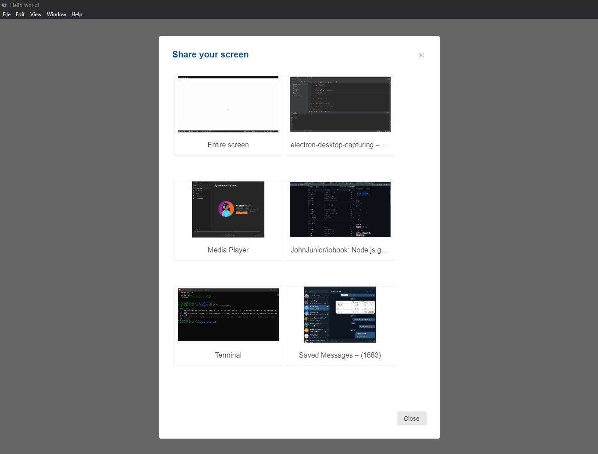

# electron-desktop-capturing

**A simple screen picker for Electron desktop sharing**

This is a minimal Electron application with a screen picker using `desktopCapturer.getSources()` for a screen sharing functionality.

```bash
git clone https://github.com/JohnJunior/electron-desktop-capturing.git
npm install
npm run start
```




